# 1. Sammanfattning

- **Pristoppen passerades andra kvartalet 2025.** Skogsstyrelsens avräkningspriser för leveransvirke, hela landet, nådde 1 107 kr/m³fub för tallsågtimmer, 1 313 för gransågtimmer och 735 för barrmassaved under 2025K2. Tredje kvartalet 2026 var nivåerna 845, 1 103 respektive 566 kr/m³fub, alltså −24 %, −16 % och −23 % från toppen. Preliminärt
- **Nivåerna är ändå historiskt höga.** Helåret 2025 var leveransvirkespriset 1 040 kr/m³fub för tallsågtimmer, 1 246 för gransågtimmer, 698 för barrmassaved och 673 för lövmassaved. Sågtimmer låg 2025 cirka 104 % över det uppskattade snittet för 2019–2023 nominellt och cirka 75 % över realt. Jämförelsen störs av ett metodbyte 2025 och ska läsas som en storleksordning. Utfall / Bedömning
- **Köparnas prislistor har fallit snabbare än statistiken.** Skogens jämförpriser för gran i slutavverkning sjönk mellan september 2025 och augusti 2026 med 20 % hos Södra (1 170 → 934 kr/m³fub), 24 % hos Holmen i Dalarna och 15 % hos Mellanskog i Mälardalen. Listpriset för barrmassaved sänktes med 40–130 kr/m³fub mellan januari och augusti 2026 hos flertalet köpare. Eftersom avräkningspriserna släpar efter kontrakten väntas statistiken visa ytterligare nedgång under 2026K4. Bedömning
- **Energisortimenten är stabila på hög nivå.** Skogsflis till värmeverk kostade 366 kr/MWh 2026K2, jämfört med 376 kr/MWh i snitt 2025 och 220 kr/MWh i snitt 2019–2023. Förädlade trädbränslen har fallit med cirka 10 % sedan 2025. Bränsleved i avverkningsuppdrag sjönk till 427 kr/m³fub 2026K3, −23 % mot samma kvartal 2025. Utfall / Preliminärt
- **Volymerna är de lägsta på över ett decennium.** Bruttoavverkningen var 87,0 miljoner m³sk 2025, den lägsta sedan 2013, och Skogsstyrelsen prognostiserar 84,6 miljoner m³sk 2026. Industrins rundvirkesförbrukning sjönk från 77,0 miljoner m³fub 2021 till 71,2 miljoner 2025. Importen minskade med cirka 9 % 2025, helt genom lägre massavedsimport. Utfall / Prognos
- **Efterfrågan försvagas strukturellt.** Åtta sågverk har lagts ned eller malpåsats 2025–2026. Exporten av sågade trävaror var 8 % lägre januari–maj 2026 än året innan, och produktionen väntas minska med 4,5 % 2026. Massamarknaden präglas av överutbud, och Stora Enso har stängt en barrmassalinje i Skutskär. EUDR börjar tillämpas den 30 december 2026.
- **Basscenariot för 2027 är sidledes till svagt fallande priser.** Leveransvirke, hela landet: tallsågtimmer 780–880, gransågtimmer 1 030–1 130 och barrmassaved 520–580 kr/m³fub. Skogsflis till värmeverk väntas ligga på 340–375 kr/MWh. En privat skogsägare bör undvika att låsa in långa kontrakt på dagens låga listpriser utan prisklausul, men inte vänta med att avverka storm- och barkborreskadad gran. Prognos

# 2. Metod, definitioner och källor

## 2.1 Definitioner

Rapporten använder branschens etablerade måttenheter. **m³fub** (fast kubikmeter under bark) är volymen av själva veden utan bark och används för timmer och massaved. **m³sk** (skogskubikmeter) avser hela stamvolymen ovan stubbe inklusive bark och topp och används i Skogsstyrelsens avverkningsstatistik. **m³f** (fast kubikmeter) används av SCB i utrikeshandelsstatistiken och inkluderar ibland bark. Energisortiment prissätts i **kr/MWh**, det vill säga per megawattimme energiinnehåll fritt förbrukare.

Tre affärsformer förekommer. Vid **leveransvirke** avverkar och skotar skogsägaren själv, eller låter en entreprenör göra det, och levererar virket vid bilväg; priset ersätter då även avverkningsarbetet. Vid **avverkningsuppdrag** anlitar ägaren köparen för avverkningen och får virkets värde vid bilväg minus avverkningskostnaden, som debiteras separat. Vid **rotpost** köper köparen virket på rot till ett fast pris eller ett pris per m³fub, och köparen står för avverkningen. **Avräkningspris** är Skogsstyrelsens begrepp för det faktiskt avräknade priset vid bilväg efter tillägg och avdrag, före avdrag för avverkningskostnad. **Sågtimmer** omfattar enligt Skogsstyrelsen normaltimmer, klentimmer, kubb och specialsortiment. Klentimmer redovisas inte separat i någon offentlig serie. **GROT** står för grenar och toppar som tas ut som bränsle. **Energived** eller bränsleved är stamved av låg kvalitet som säljs som bränsle.

Alla priser är **nominella** (löpande priser) om inget annat anges. Reala jämförelser har gjorts med SCB:s KPI (1980=100, årsmedel). Konsumentprisindex steg med cirka 16,8 % mellan snittet för 2019–2023 och 2025.

## 2.2 Källor och prisbaser

Den officiella prisstatistiken är **Skogsstyrelsens avräkningspriser** (JO0303). Den finns per kvartal och landsdel för leveransvirke från 2019K1 och för avverkningsuppdrag från 2025K1. Från och med 2025K1 samlas statistiken in på ett nytt sätt: köparna rapporterar faktiskt avräknade priser, i stället för att priser beräknas från köparnas prislistor via Biometrias mätsystem. Serierna 2019–2024 och 2025–2026 är därför **inte helt jämförbara**. I diagrammen markeras metodbytet med en lodrät linje. Senaste preliminära kvartal är 2026K3, publicerat 3 november 2026.

För trädbränslen används **Energimyndighetens** kvartalsvisa trädbränsle- och torvpriser (EN0307), som anger pris fritt förbrukare exklusive skatt, uppdelat på värmeverk och industri. Senaste kvartal är 2026K2, uppdaterat 30 oktober 2026. Volymer kommer från **Skogsstyrelsens** bruttoavverkningsstatistik och **Biometrias** rapport om skogsindustrins virkesförbrukning 2021–2025 (28 maj 2026). Biometria publicerar inte inmätta volymer per månad eller kvartal offentligt; endast årstotalen för 2025 är tillgänglig.

Som komplement till den officiella statistiken används tidningen **Skogens jämförpriser**. Dessa är medelpriser i slutavverkning, beräknade med Timan-programmet ur köparnas egna prislistor för ett normalbestånd i en mellansvensk exempelskog och avser avverkningsuppdrag. Jämförpriserna är listpriser och ligger därför före avräkningspriserna i tid, men de visar inte faktiskt betalda priser.

## 2.3 Referensperioden 2019–2023

Femårssnittet 2019–2023 är beräknat för hela landet. Årspriserna för 2019–2021 är officiella utfall (sågtimmer 522, 483 och 525 kr/m³fub; massaved 340, 302 och 288 kr/m³fub). Officiella årsvärden för 2022 och 2023 har inte gått att hämta, så de är **härledda**:

- 2022 beräknas från Skogsstyrelsens uppgift att sågtimmerpriset steg 14 % och massavedspriset 19 % jämfört med 2021.
- 2023 beräknas baklänges från 2024 års kvartalsmedel och uppgiften att priserna steg 30 % (sågtimmer) och 18 % (massaved) från 2023 till 2024.

Resultatet blir ett snitt för 2019–2023 på cirka **561 kr/m³fub för sågtimmer** och **351 kr/m³fub för massaved** Härlett. För landsdelarna redovisas i stället snittet 2019–2021 (tabell A4), eftersom procentförändringarna för 2022–2023 inte finns per landsdel och sortiment. För trädbränslen och bruttoavverkning finns fullständiga utfall för 2019–2023.

## 2.4 Kända databrister och osäkerheter

- **Metodbyte 2025:** avräkningspriser från 2025 jämförs med prislistebaserade priser före 2025. Nivåskiftet mellan 2024K4 och 2025K1 är delvis metodberoende.
- **Rotpostpriser:** någon officiell rotpoststatistik finns inte. Skogens jämförpriser för avverkningsuppdrag används som närmaste indikator.
- **Klentimmer, björkmassaved och GROT:** klentimmer ingår i sågtimmer. Björkmassaved redovisas sedan 2024 som ”massaved av lövträd”. GROT ingår i Energimyndighetens kategori skogsflis och kan inte särredovisas.
- **Brännved till hushåll:** ingen officiell prisstatistik har hittats. Kategorin behandlas därför bara kvalitativt.
- **Lager hos industrin:** Skogsstyrelsens lagerstatistik (JO0306) har inte gått att hitta i nyare utgåva än årsskiftet 2022/2023. Då var lagret 7,7 miljoner m³fub, varav cirka 3,0 miljoner sågtimmer, 3,8 miljoner massaved och 0,8 miljoner massaflis. Lagernivåer för 2024–2026 saknas.
- **Motstridiga siffror:** se tabell 1.
- **Regionindelning:** Energimyndighetens regioner (1 = norr, 2 = mitt, 3 = syd) följer länsgränser och skiljer sig från Skogsstyrelsens landsdelar.
- **Godtagbara men osäkra skattningar:** årsmedel för 2024–2026 i bilaga A är enkla medelvärden av kvartal. De skiljer sig något från volymvägda årsvärden; för 2025 är det officiella volymvägda tallpriset 1 040 kr/m³fub, medan kvartalsmedlet är 1 023 kr/m³fub.

Tabell 1. Motstridiga uppgifter mellan källor och hur de hanteras

| Uppgift | Källa A | Källa B | Förklaring / hantering |
|---|---|---|---|
| Import av rundvirke 2025 | Biometria: 7,7 milj. m³fub | Skogsstyrelsen/SCB: 8,4 milj. m³f | SCB inkluderar bränsleved och mäter i m³f. Biometria redovisar import till industrin. Båda redovisas. |
| Bruttoavverkning 2024 | 87,1 milj. m³sk (prel., juni 2025) | 87,7 milj. m³sk (juni 2026) | Reviderad uppgift används. |
| Inmätt volym 2025 (Biometria) | ”knappt 94 milj. m³fub” | ”ca 94,7 milj. m³fub” | Båda finns i samma rapport. Komponenterna summerar till 94,7, som används. |
| Bruttoavverkning 2019 | 92,8 milj. m³sk | 92,3 milj. m³sk | Båda förekommer i samma publikation. 92,8 används. |
| LULUCF-mål 2030 för Sverige | 47,3 milj. ton CO₂e | 47,5 milj. ton CO₂e | Olika underlag från Naturvårdsverket. Båda anges. |
| EUDR för små och mikroföretag | 30 juni 2027 (gäller ej trä enligt SCA) | 30 december 2026 | För trä gäller 30 december 2026 för stora och medelstora operatörer. Småföretagens datum bör kontrolleras i EU-tidningen. |

Källor: Biometria (2026), Skogsstyrelsen (2025, 2026), Naturvårdsverket, SCA, Papper &amp; Massa.

# 3. Marknadsöversikt 2024–2026

Perioden 2024–2026 har två tydliga faser. Under **2024 och första halvåret 2025** steg priserna kraftigt. Leveransvirkespriset för sågtimmer steg med 30 % och massavedspriset med 18 % från 2023 till 2024. Prisuppgången fortsatte till toppen i 2025K2. Bakom den låg ett strukturellt råvaruunderskott: avverkningen sjönk, importen från Ryssland och Belarus upphörde efter EU:s sanktioner 2022, granbarkborrens angrepp minskade utbudet av skadad gran, och industrin konkurrerade om virket för att fylla befintlig kapacitet.

Från **andra halvåret 2025** vände marknaden. Sågverkens marginaler pressades av höga råvarukostnader i kombination med svag byggkonjunktur, ett kraftigt prisfall på trävaror i USA efter sommaren 2025, höga energi- och transportkostnader och en starkare krona. Massamarknaden präglades av överutbud. Industrin svarade med att sänka sina prislistor, i flera steg under december 2025 till augusti 2026. Stormen Johannes i december 2025 fällde knappt 11 miljoner m³ skog i Dalarna och Gävleborg, och stormen Dave i april 2026 ytterligare drygt 2 miljoner m³ i Götaland. Tillsammans ökade de utbudet tillfälligt just när efterfrågan föll.

Tabell 2. Nyckeltal, hela landet

| Nyckeltal | Snitt 2019–2023 | 2024 | 2025 | 2026 (senast) | Status 2026 |
|---|---:|---:|---:|---:|---|
| Sågtimmer, leveransvirke (kr/m³fub) | 561 (H) | 878 (K) | 1 143 (K) | 981 (K3) | Preliminärt |
| Tallsågtimmer, leveransvirke (kr/m³fub) | – | 820 (K) | 1 040 | 845 (K3) | Preliminärt |
| Gransågtimmer, leveransvirke (kr/m³fub) | – | 914 (K) | 1 246 | 1 103 (K3) | Preliminärt |
| Massaved totalt, leveransvirke (kr/m³fub) | 351 (H) | 567 (K) | 689 (K) | 565 (K3) | Preliminärt |
| Skogsflis, värmeverk (kr/MWh) | 220 | 366 | 376 | 366 (K2) | Utfall |
| Bruttoavverkning (milj. m³sk) | 93,3 | 87,7 | 87,0 (prel.) | 84,6 | Prognos |
| Industrins rundvirkesförbrukning (milj. m³fub) | – | 72,9 | 71,2 | saknas | – |
| Import av rundvirke, Biometria (milj. m³fub) | 6,9 | 8,6 | 7,7 | saknas | – |

Enhet enligt rad, löpande priser. H = härlett, K = enkelt medel av kvartal, utan markering = officiellt årsvärde. Källor: Skogsstyrelsen (JO0303, JO0312), Energimyndigheten (EN0307), Biometria (2026), egna beräkningar.

# 4. Timmer

Sågtimmerpriserna har följt samma mönster i alla landsdelar, men på mycket olika nivåer. Götaland ligger högst, eftersom sågverkstätheten och granandelen är störst där. Norra Norrland ligger lägst, med längre transportavstånd och mindre dimensioner. Under 2026K3 var leveransvirkespriset för tallsågtimmer 1 057 kr/m³fub i Götaland och 704 kr/m³fub i Norra Norrland, en skillnad på drygt 350 kr/m³fub (figur 1).

Figur 1. Tallsågtimmer, leveransvirke: avräkningspris per landsdel och kvartal, 2023K3–2026K3

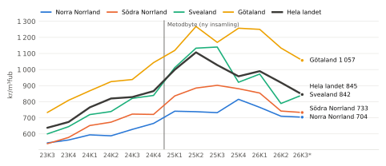

Enhet: kr/m³fub, löpande priser, vid bilväg. 2026K3 preliminärt (*). Lodrät linje = metodbyte 2025K1 (ny insamling av avräkningspriser). Källa: Skogsstyrelsen, tabell JO0303_3ny.

**Tall har fallit mer än gran.** Nationellt sjönk tallsågtimret med 18 % mellan 2025K3 och 2026K3, medan gransågtimret sjönk med 9 %. Nedgången för tall var störst i Svealand (−26 %) och Södra Norrland (−19 %). Norra Norrland, där tall dominerar avverkningen, föll bara 4 %. Där fanns heller aldrig någon motsvarande topp under 2025. Skillnaden mellan trädslagen speglar att efterfrågan på furu, bland annat till export av snickerivirke, har varit svagare än för gran. Sveaskog uppger att priset på gransågtimmer nu ligger högre än priset på tallsågtimmer även i Norrbotten och Västerbotten, och höjde timmerpriserna där i juli 2026.

Figur 2. Gransågtimmer, leveransvirke: avräkningspris per landsdel och kvartal, 2023K3–2026K3

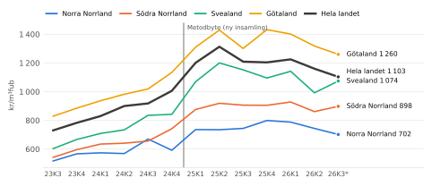

Enhet: kr/m³fub, löpande priser, vid bilväg. 2026K3 preliminärt (*). Källa: Skogsstyrelsen, tabell JO0303_3ny.

Gransågtimret toppade nationellt på 1 313 kr/m³fub (2025K2) och låg på 1 103 kr/m³fub 2026K3. I Götaland var nivån 1 260 kr/m³fub, 12 % under toppen på 1 432 kr/m³fub i 2025K4. Svealand visade en uppgång mellan 2026K2 och 2026K3, från 992 till 1 074 kr/m³fub. Den bör tolkas försiktigt: Skogsstyrelsen påpekar att avräkningspriser speglar virke som avräknats under kvartalet, och det kan ha kontrakterats tidigare, till exempel stormvirke från Johannes som säkrats till vinterns prisnivå.

Priserna i **avverkningsuppdrag** följer samma förlopp (figur 3). Nationellt låg tallsågtimmer på 822 och gransågtimmer på 1 124 kr/m³fub under 2026K3, mot 991 och 1 195 kr/m³fub i snitt 2025. Skillnaden mellan leveransvirke och avverkningsuppdrag är liten för gran nationellt. Det förklaras av att leveransvirke till stor del levereras i norr, där prisnivån är lägre, så sammansättningen skiljer sig mellan formerna.

Figur 3. Avverkningsuppdrag, hela landet: avräkningspris per sortiment och kvartal, 2025K1–2026K3

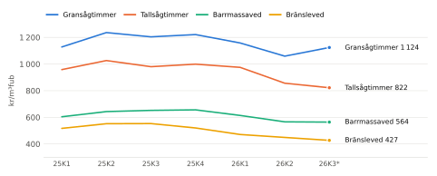

Enhet: kr/m³fub, löpande priser, vid bilväg, före avdrag för avverkningskostnad. 2026K3 preliminärt (*). Serien startar 2025K1. Källa: Skogsstyrelsen, tabell JO030304a.

**Köparnas prislistor** visar en snabbare och djupare nedgång än avräkningspriserna (figur 4). Skogens medelpris för gran i slutavverkning sjönk mellan september 2025 och augusti 2026 med:

- 20 % hos Södra, från 1 170 till 934 kr/m³fub,
- 21 % hos Stora Enso i Västra Götaland,
- 25 % hos Holmen i Östergötland och Småland,
- 24 % hos Holmen i Dalarna.

I norr var förändringen mindre. Hos SCA och Holmen i Västernorrland sjönk priserna med 5–8 %, och Norra Skogs priser i Västerbotten var i stort sett oförändrade under hela perioden. Mönstret bekräftar att nedgången främst drivs av sågverken i södra och mellersta Sverige.

Figur 4. Köparnas prislistor: medelpris för gran i slutavverkning, oktober 2024, september 2025 och augusti 2026

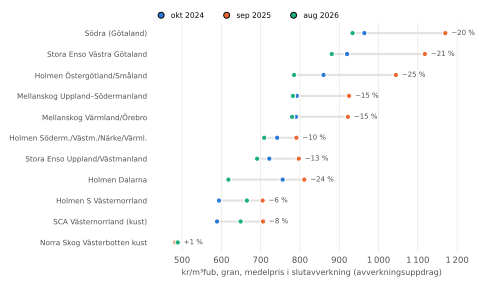

Enhet: kr/m³fub, avverkningsuppdrag (avverkningskostnad belastar säljaren), exkl. moms, inkl. eventuella medlems- och garantipremier enligt respektive lista. Procentsiffran anger förändring september 2025 – augusti 2026. Regionavgränsningar kan skilja något mellan tidpunkterna. Källa: Skogen, ”Jämförpriser, slutavverkning medelpris” 9.10.2024, 8.9.2025 och 10.8.2026.

# 5. Massaved

Massavedspriserna steg kraftigt 2024–2025 och var 2025 drygt dubbelt så höga som referenssnittet. Nationellt var leveransvirkespriset för massaved 689 kr/m³fub (kvartalsmedel) 2025, mot cirka 351 kr/m³fub i snitt 2019–2023, en nominell uppgång på 97 % och en real på 68 %. Sedan toppen 2025K2 har priset fallit till 565 kr/m³fub (2026K3). Nedgången är tydligast i Götaland och Svealand (figur 5). I Norra Norrland har priset hållits på 520–575 kr/m³fub sedan 2025, och 2026K3 låg landsdelarna mellan 512 och 604 kr/m³fub, den minsta regionala spridningen under perioden.

Figur 5. Massaved totalt, leveransvirke: avräkningspris per landsdel och kvartal, 2023K3–2026K3

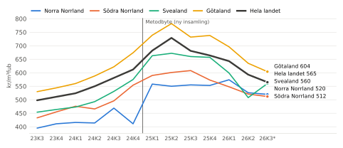

Enhet: kr/m³fub, löpande priser, vid bilväg. ”Massaved totalt” omfattar barr- och lövmassaved. För Götaland redovisas inte barr och löv separat. 2026K3 preliminärt (*). Källa: Skogsstyrelsen, tabell JO0303_3ny.

**Barrmassaved och lövmassaved** följs åt (figur 6). Nationellt var barrmassaved 566 och lövmassaved 564 kr/m³fub under 2026K3. Under 2025 låg barrmassaveden i genomsnitt drygt 20 kr/m³fub över lövmassaveden, men den skillnaden har i stort sett försvunnit. Björkmassaved redovisas inte längre separat i den officiella statistiken. I köparnas prislistor i januari 2026 låg björk i norr mellan 20 kr/m³fub under och 30 kr/m³fub över barrmassaved, och i södra Sverige 50–60 kr/m³fub under.

Figur 6. Barr- och lövmassaved, leveransvirke, hela landet, 2023K3–2026K3

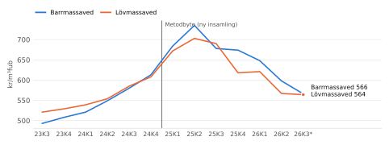

Enhet: kr/m³fub, löpande priser, vid bilväg. Lövmassaved omfattar sedan 2024 även björkmassaved. 2026K3 preliminärt (*). Källa: Skogsstyrelsen, tabell JO0303_3ny.

Även här ligger prislistorna före statistiken. Mellan januari och augusti 2026 sänkte nästan alla köpare listpriset för barrmassaved (figur 7):

- Södra, från 560 till 480 kr/m³fub,
- Mellanskog och Sveaskog, från 560 till 460 kr/m³fub,
- Holmen i Dalarna, från 480 till 350 kr/m³fub (−27 %).

Undantaget är Norra Skog, som låg lägst redan i januari och höjde barrmassaveden något, från 400 till 410 kr/m³fub. Skillnaderna mellan köpare är stora inom samma region. I Dalarna var listpriset för barrmassaved i augusti 2026 350 kr/m³fub hos Holmen och Billerud men 460 kr/m³fub hos Sveaskog, och Mellanskogs listpris var 410 kr/m³fub. Massaindustrins svaga lönsamhet förklarar sänkningarna. NBSK, den europeiska referensen för blekt barrsulfatmassa, handlades kring 730–745 USD/ton netto i januari 2026 enligt Fastmarkets. Massaindustrins import av rundvirke minskade dessutom från 7,2 till 5,7 miljoner m³fub 2025, vilket visar att industrin har dragit ned på inköpen.

Figur 7. Köparnas prislistor: barrmassaved (prima), januari och augusti 2026

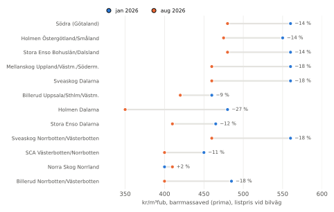

Enhet: kr/m³fub vid bilväg, exkl. moms, exkl. eventuellt transportavdrag. Listpriset är enligt köparna ett golv i förhandlingen. Procentsiffran anger förändring januari–augusti 2026. Källa: Skogen, ”Jämförpriser, massaved” 7.1.2026 och 10.8.2026.

# 6. Bränsleved och energisortiment

Trädbränslepriserna steg kraftigt 2022–2024, men har därefter utvecklats betydligt stabilare än virkespriserna (figur 8). Skogsflis till värmeverk, som också omfattar flisad GROT, låg på 366 kr/MWh under 2026K2. Det är i nivå med 2024 (366) och strax under 2025 (376). Jämfört med snittet 2019–2023 på 220 kr/MWh är nivån 66 % högre nominellt. Förädlade trädbränslen, främst pellets och briketter, föll däremot från 497 kr/MWh i snitt 2025 till 447 kr/MWh under 2026K2, och biprodukter från sågverk till värmeverk sjönk från 320 till 289 kr/MWh. Returträ har fallit mest, från 293 till 197 kr/MWh mellan 2025K1 och 2026K2, och pressar betalningsviljan för andra bränslen hos de anläggningar som kan elda returträ.

Figur 8. Trädbränslepriser per kvartal, 2019K1–2026K2

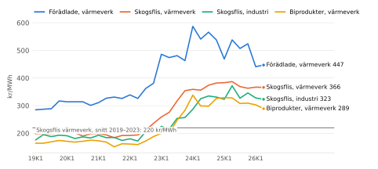

Enhet: kr/MWh fritt förbrukare, exkl. skatt, löpande priser. Skogsflis omfattar flisade skogsbränslen inklusive GROT och energived. Den horisontella linjen visar snittet 2019–2023 för skogsflis till värmeverk. Källa: Energimyndigheten, Trädbränsle- och torvpriser (EN0307), tabell 1.

Regionalt är skogsflisen dyrast i söder och billigast i norr (figur 9). Under 2026K2 betalade värmeverken 371 kr/MWh i region 3 (Götaland exkl. Östergötland), 368 kr/MWh i region 2 (Svealand, Östergötland och Gävleborg) och 323 kr/MWh i region 1 (övriga Norrland). Prisskillnaden mellan region 3 och region 1 har minskat från 67 kr/MWh i 2025K1 till 48 kr/MWh, eftersom flispriset i syd har fallit något medan det legat stilla i norr.

Figur 9. Skogsflis till värmeverk per region, 2025K1–2026K2

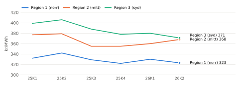

Enhet: kr/MWh fritt förbrukare, exkl. skatt, löpande priser. Region 1: Västernorrland, Jämtland, Västerbotten, Norrbotten. Region 2: Stockholm, Uppsala, Södermanland, Östergötland, Värmland, Örebro, Västmanland, Dalarna, Gävleborg. Region 3: Jönköping, Kronoberg, Kalmar, Gotland, Blekinge, Skåne, Halland, Västra Götaland. Källa: Energimyndigheten, EN0307, tabell 5.

För skogsägaren är det **bränsleveden vid bilväg** som är relevant. Skogsstyrelsens avräkningspris för bränsleved i avverkningsuppdrag var 517–553 kr/m³fub under 2025 och har därefter fallit till 472 (2026K1), 450 (2026K2) och 427 kr/m³fub (2026K3, preliminärt). Det är −23 % mot 2025K3. Bränsleved redovisas inte för leveransvirke, eftersom underlaget är för litet. Nedgången är större än för flis fritt värmeverk, vilket tyder på att transport- och flisningskostnaderna tar en större del av energivärdet och att stormvirke från Johannes har ökat utbudet av bränsleved i Mellansverige. Den totala volymen bränslesortiment som Biometria mätte in var 5,3 miljoner m³fub 2025. Någon officiell prisstatistik för **brännved till hushåll** har inte hittats, och priserna i detaljhandeln (säckad björkved) följer framför allt arbets- och distributionskostnader snarare än råvarupriset.

# 7. Drivkrafter och strukturella förändringar

## 7.1 Efterfrågan

**Sågade trävaror.** Den svenska sågverksindustrin har haft två svaga år i rad. Enligt Skogsindustrierna är 2024–2025 de svagaste åren för hemmamarknaden på 25 år, trots att leveranserna i Sverige ökade med 12 % under 2025. Exporten minskade med cirka 8 % under januari–maj 2026 jämfört med året innan, främst till följd av ett kraftigt fall i exporten till USA, och produktionen väntas minska med 4,5 % under 2026. Exportpriserna pressades av hög produktion och av att trävarupriserna i USA i det närmaste kraschade efter sommaren 2025. Under samma period betalade sågverken rekordhöga timmerpriser, och det är kombinationen av höga råvarukostnader och låga produktpriser som har drivit prissänkningarna på timmer. En starkare krona har ytterligare försämrat exportlönsamheten. Tyskland är ett undantag: importen av svenska trävaror ökade där, efter problem med den inhemska råvaruförsörjningen.

**Massa, papper och kartong.** Massaindustrins totala råvaruförbrukning minskade från 48,4 till 46,6 miljoner m³f under 2025. Europeiska NBSK-producenter tog omfattande driftstopp under 2025 utan permanenta kapacitetsminskningar. Stora Enso har dock stängt linje 3 för barrmassa i Skutskär (cirka 100 000 ton per år) för att koncentrera bruket på fluffmassa.

**Energi och fjärrvärme.** Värmeverkens betalningsvilja för skogsflis har legat stabilt på 360–390 kr/MWh sedan början av 2024. Biprodukter och returträ har blivit billigare och fungerar som substitut, vilket dämpar efterfrågan på primära skogsbränslen. Den låga sågverksproduktionen minskar samtidigt tillgången på biprodukter som spån och bark, vilket stödjer flispriset.

## 7.2 Utbud

**Import.** Efter EU:s sanktioner 2022 upphörde i praktiken importen av rundvirke och flis från Ryssland och Belarus. Importen ersattes med virke från Baltikum, Norge och Finland. Enligt Skogsstyrelsen kom 95 % av importen 2022 från Norge, Lettland, Finland och Estland. Importen till industrin ökade kraftigt 2024, med 26 % till 8,6 miljoner m³fub enligt Biometria, men minskade till 7,7 miljoner m³fub 2025. Hela minskningen gällde massaved (figur 10). Sågverkens import ökade i stället från 1,4 till 2,0 miljoner m³fub, och barrsågtimmerimporten ökade med 1,0 miljon m³. Även de baltiska priserna har fallit: Skogens uppgifter för Lettland visar barrmassaved vid bilväg på 795 kr/m³fub i september 2024 och 478 kr/m³fub i maj 2026. Det gör import av massaved till ett realistiskt alternativ för kustnära bruk och begränsar utrymmet för svenska prishöjningar.

Figur 10. Import av rundvirke, 2019–2025

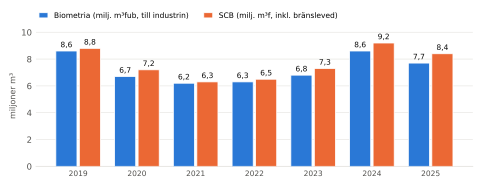

Enhet: miljoner m³fub (Biometria) respektive m³f (SCB). SCB:s siffror inkluderar bränsleved och ligger därför något högre. Källa: Biometria, ”Skogsindustrins virkesförbrukning 2021–2025” (2026), tabell över import.

**Avverkning och skogsägarnas säljvilja.** Bruttoavverkningen har sjunkit från 96,6 miljoner m³sk 2021 till 87,0 miljoner m³sk 2025, och Skogsstyrelsen prognostiserar 84,6 miljoner m³sk för 2026, den lägsta nivån sedan 2012 (figur 11). Nedgången under 2025 var störst i Götaland (−6 %), medan avverkningen ökade i Norra Norrland (+9 %) och Södra Norrland (+4 %). Avverkningsanmälningarna var lägre till och med augusti 2026 än året innan. Säljviljan påverkas av fallande priser: i Swedbanks Skogsbarometer (november 2026) har skogsägarnas lönsamhetstro vikit. I Handelsbankens undersökning i maj 2026 räknade både köpare och skogsägare med lägre virkespriser under året, med upp till 10 % nedgång enligt ägarna och störst förväntad nedgång i Norra Norrland. Samtidigt uppgav 62 % av skogsägarna att de funderade på att avverka inom tolv månader.

Figur 11. Bruttoavverkning, 2019–2026

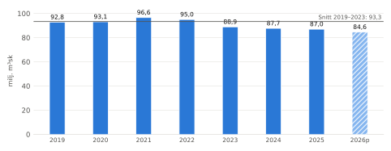

Enhet: miljoner m³sk. 2021 är preliminärt i senast läsbara publikation, 2025 är preliminärt och 2026 är Skogsstyrelsens prognos (22 sep 2026, randig stapel). Den horisontella linjen visar snittet 2019–2023. Källa: Skogsstyrelsen (JO0312, statistikfaktablad och pressmeddelanden 2021–2026).

**Skador.** Granbarkborrens utbrott 2018–2023 dödade enligt Skogsstyrelsen cirka 34 miljoner m³ gran, med en topp på omkring 16 miljoner m³ per år 2020–2021. År 2024 var skadorna nere i cirka 0,36 miljoner m³. Riskbilden har ökat igen efter stormarna: Johannes (27–28 december 2025) fällde knappt 11 miljoner m³, främst i Dalarna och Gävleborg, och är den fjärde mest skadegörande stormen sedan mätningarna började. Dave (april 2026) fällde drygt 2 miljoner m³ i Västra Götaland, Jönköpings län och angränsande län. Stormvirke som ligger kvar under sommaren är ett yngelmaterial för granbarkborren. Upparbetningen försenades av snö och svår terräng och väntades pågå åtminstone till sommaren 2026.

## 7.3 Policy och regelverk

**EUDR**, EU:s avskogningsförordning, ändrades i december 2025 och börjar tillämpas den **30 december 2026** för stora och medelstora operatörer. Mikro- och småföretag som är primärproducenter lämnar en förenklad engångsdeklaration. Kommissionens förenklingsöversyn, som publicerades den 4 maj 2026, öppnade inte rättsakten igen. Den föreslog i stället justeringar via delegerad akt och uppskattar att kostnaderna minskar med cirka 75 %. Skogsägarnas europeiska organisation CEPF anser att översynen är otillräcklig. För svenska skogsägare innebär EUDR främst krav på geolokalisering och dokumentation som köparna i praktiken hanterar, men övergången kan skapa tillfälliga flaskhalsar i handeln kring årsskiftet 2026/2027. Bedömning

**LULUCF.** Sveriges mål för nettoupptag i markanvändningssektorn 2030 är 47,3–47,5 miljoner ton CO₂e beroende på underlag. Naturvårdsverket bedömer att målet är svårt att nå utan minskad avverkning, och underskottet i LULUCF påverkar även möjligheten att klara ansvarsfördelningsförordningen. Någon styrning som direkt begränsar avverkningen har inte införts, men frågan är en politisk risk på längre sikt.

**Skogsstyrelsens tillsyn** omfattar bland annat avverkningsanmälningar, föryngringskrav och åtgärder mot granbarkborre efter stormar. Regeringen tillförde myndigheten 20 miljoner kronor för 2026 för arbetet efter stormarna. Kravet att ta ut stormfälld gran inom given tid driver avverkningen i drabbade områden oberoende av prisläget.

**Skatteregler.** Proposition 2025/26:69 *Förbättrat regelverk om beskattning av skog* trädde i kraft den **1 april 2026**. Den avskaffar skatten på ränta på skogskontomedel, inför ett naturvårdskonto för ersättning vid naturvårdsavtal och öppnar för skogskonton i kreditinstitut inom EES. Skogskontot blir därmed mer attraktivt för att jämna ut inkomster från ett högprisår, vilket kan minska trycket att sälja när priserna är som högst. Skogsavdrag och räntefördelning är i övrigt oförändrade enligt de källor som granskats.

## 7.4 Industrins kapacitet

Under 2025–2026 har åtta sågverk lagts ned eller malpåsats och cirka 450 personer varslats, enligt Svenskt Trä. Kända förändringar som påverkar den regionala efterfrågan är:

- Bergkvist Siljans såg i Mora, cirka 115 000 m³ per år, stängdes i mars 2026.
- Vida lägger ned två av sina 15 sågverk, Urshult och Orrefors.
- Moelven lägger ned sågen i Årjäng (september 2026), den andra nedläggningen i Värmland på drygt ett år.
- Holmen avvecklar sågverksamheten i Kroksjö utanför Skellefteå (november 2026) och beskriver marknaden för trävaror som den sämsta på decennier.
- Stora Enso planerar att stänga KL-träproduktionen vid Gruvön vid årsskiftet 2026/27 och har stängt en barrmassalinje i Skutskär.

Nedläggningarna är koncentrerade till Mellansverige och Småland och minskar konkurrensen om timret lokalt. Industrins förbrukning minskade mellan 2021 och 2025 mest i Svealand, från 23,2 till 20,1 miljoner m³fub (figur 12).

Figur 12. Industriell förbrukning av rundvirke per landsdel, 2021–2025

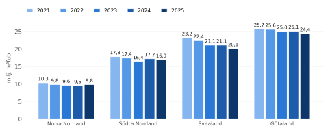

Enhet: miljoner m³fub, inklusive import. Massabruk inkluderar två spånskivefabriker. Sågverk inkluderar bedömd förbrukning i små sågverk. Källa: Biometria, ”Skogsindustrins virkesförbrukning 2021–2025”, tabell 2.

# 8. Regionala skillnader och köparlandskap

**Götaland** har landets högsta timmer- och massavedspriser. Där finns en tät sågverksstruktur, hög granandel (cirka 70 % av avverkningen) och Södras medlemsägda industri. Här föll också prislistorna mest under 2026, och avverkningen minskade med 6 % under 2025. **Svealand** har haft störst prisfall i statistiken: tallsågtimret sjönk med 26 % på ett år, och industrins förbrukning har minskat mest, i takt med nedläggningar i Dalarna och Värmland. **Södra Norrland** präglas av stora skogsbolag (SCA, Holmen) och storm Johannes. **Norra Norrland** har låga men stabila priser, och där var avverkningen den enda som ökade 2025.

**Skogsägarföreningar och skogsbolag** skiljer sig i prissättning och ersättningsstruktur. Föreningarna (Södra, Mellanskog, Norra Skog, VVDS) betalar medlemspremier, vanligen 30 kr/m³fub för timmer, och **efterlikvider** som beror på industrins resultat. Efterlikviderna har minskat kraftigt:

- Södra betalade 130 kr/m³fub för normaltimmer och 75 kr/m³fub för massaved för 2024, men 87 respektive 45 kr/m³fub för 2025.
- Mellanskogs efterlikvid sjönk från 3,7 % till 1 % av virkesvärdet.
- Norra Skogs efterlikvid sjönk från 75 till 40 kr/m³fub.

Skogsbolagen (Holmen, SCA, Sveaskog, Stora Enso, Billerud) betalar i stället enbart listpris plus förhandlade tillägg. Både föreningar och bolag betalar certifieringspremier, oftast 20–40 kr/m³fub för dubbelcertifierat virke.

**Skillnaderna mellan köpare är stora.** I augusti 2026 varierade medelpriset för gran i slutavverkning mellan 618 kr/m³fub (Holmen, Dalarna) och 791 kr/m³fub (Sveaskog, Svealand) inom samma geografiska område. För barrmassaved varierade listpriset mellan 350 och 460 kr/m³fub. Prislistorna är enligt köparna ett golv i förhandlingen. Slutpriset beror på volym, virkeskvalitet, säsong, väg- och terrängförhållanden och lokal konkurrens.

Tabell 3. Avtalsformer: egenskaper och riskfördelning

| Avtalsform | Vem avverkar | Prisbas | Prisrisk | Passar när |
|---|---|---|---|---|
| Leveransvirke | Skogsägaren (själv eller via entreprenör) | Pris vid bilväg enligt lista, inkl. avverkningsarbetet | Säljaren bär kvalitets- och volymrisk | Ägaren har egen maskinkapacitet eller gallrar själv |
| Avverkningsuppdrag | Köparen | Lista vid bilväg minus avverkningskostnad | Säljaren bär volym- och apteringsutfall; pris låses ofta vid kontrakt | Normal slutavverkning; flest köpare att jämföra |
| Rotpost | Köparen | Fast pris eller pris per m³fub på rot | Köparen bär volym- och kostnadsrisk | Små eller svåra bestånd, eller när ägaren vill ha fast belopp |

Källa: egen sammanställning baserad på Skogsstyrelsens definitioner och köparnas prislistor.

# 9. Utsikter och scenarier

Utsikterna nedan är **prognoser och bedömningar** för resten av 2026 och 2027. Gemensam utgångspunkt är att avräkningspriserna för 2026K4 och 2027K1 kommer att påverkas av de listprissänkningar som genomfördes under våren och sommaren 2026, eftersom avräkning sker med en eftersläpning på ett till tre kvartal. UNECE/FAO:s Timber Committee prognostiserade i november 2025 att produktionen av sågat barrträ i UNECE-regionen minskar med 1,2 % 2026, och att rundvirkesuttaget också minskar. Skogsstyrelsen väntar sig en bruttoavverkning på 84,6 miljoner m³sk 2026.

Tabell 4. Scenarier för leveransvirke- och flispriser, hela landet, 2026K4–2027K4

<table class="scen"><thead><tr><th>Scenario</th><th>Tall&shy;sågtimmer</th><th>Gran&shy;sågtimmer</th><th>Barr&shy;massaved</th><th>Skogsflis, värmeverk</th><th>Huvudsakliga antaganden</th></tr></thead><tbody>
<tr><td><strong>Bas</strong> (ca 60 %)</td><td>780–880</td><td>1 030–1 130</td><td>520–580</td><td>340–375 kr/MWh</td><td>Svag men stabil efterfrågan på trävaror; nedlagd kapacitet minskar timmerbehovet; stormvirket upparbetat under 2026; EUDR införs utan större störningar; oförändrad krona och ränta.</td></tr>
<tr><td><strong>Uppsida</strong> (ca 20 %)</td><td>880–980</td><td>1 130–1 250</td><td>580–650</td><td>370–400 kr/MWh</td><td>Europeisk byggåterhämtning från 2027; normaliserad export till USA; NBSK-priser stiger efter kapacitetsstängningar; låg avverkning skapar åter råvarubrist; svagare krona.</td></tr>
<tr><td><strong>Nedsida</strong> (ca 20 %)</td><td>680–780</td><td>900–1 030</td><td>450–520</td><td>310–340 kr/MWh</td><td>Fler sågverks- och massanedläggningar; ökat utbud av skadad gran efter granbarkborreangrepp i stormområden; billig baltisk import; starkare krona; mild vinter med lägre värmebehov.</td></tr>
</tbody></table>

Enhet: kr/m³fub vid bilväg (leveransvirke, avräkningspris) respektive kr/MWh fritt förbrukare. Löpande priser. Sannolikheterna är subjektiva. Källa: egen bedömning baserad på Skogsstyrelsen (2026K3 prel.), Skogens jämförpriser (augusti 2026), Energimyndigheten (2026K2), Skogsindustrierna, Fastmarkets och UNECE.

**Basscenario.** Avräkningspriserna fortsätter att sjunka något under 2026K4 och 2027K1, när de lägre listpriserna från sommaren 2026 slår igenom, och planar sedan ut. Tall förblir svagare än gran. Massaveden stabiliseras på dagens listnivåer, med begränsat utrymme för höjning så länge massaindustrin har god tillgång på billig baltisk ved. Skogsflis till värmeverk ligger kvar nära dagens nivå. Sveaskogs höjning av timmerpriserna i norr i juli 2026 tyder på att botten kan vara nådd i Norrland före södra Sverige.

**Uppsida.** Den största uppsidan ligger i att avverkningen nu är historiskt låg. Om efterfrågan på trävaror återhämtar sig 2027 kan råvarubristen från 2024–2025 återkomma snabbt, eftersom utbudet har minskat och importen från öst inte kommer tillbaka.

**Nedsida.** Den största nedsidan är fler nedläggningar, i kombination med ett nytt utbud av skadad gran. Stormfälld gran från Johannes och Dave som inte upparbetats i tid kan ge ökade barkborreangrepp sommaren 2027 i Dalarna, Gävleborg och västra Götaland. Det skulle öka utbudet av lågkvalitativt virke och pressa både timmer- och massavedspriserna regionalt.

# 10. Implikationer för en privat skogsägare

- **Tidpunkt.** Planerad slutavverkning av friska bestånd behöver inte forceras på dagens listpriser. Basscenariot pekar på sidledes priser under 2027, med uppsida om efterfrågan på trävaror vänder. Den som har likviditetsbehov eller ett avverkningsmoget bestånd med risk för stormskador bör dock inte vänta på en återgång till 2025 års toppnivåer. Bedömning
- **Skadad skog först.** Stormfälld och barkborreangripen gran bör prioriteras oavsett prisläge. Värdet faller snabbt, och Skogsstyrelsens krav på uttag gäller.
- **Sortimentsfördelning.** Gran betalas för närvarande bättre än tall i hela landet, och skillnaden har ökat. I blandbestånd kan en aptering som maximerar granens timmerandel öka intäkten. Massaved och energived har mindre prisrisk på kort sikt än timmer. Energived betalas lägre än massaved, men flispriset är stabilt.
- **Avtalsform.** Avverkningsuppdrag ger mest konkurrens mellan köpare och gör dem lättare att jämföra. Begär offerter från minst tre köpare: skillnaden kan uppgå till 100–170 kr/m³fub i medelpris för gran inom samma region. Pröva möjligheten att få prisgaranti eller en klausul om prisjustering uppåt för kontrakt som avverkas under 2027.
- **Föreningsmedlemskap och efterlikvid.** Räkna med betydligt lägre efterlikvider för 2026 än för 2024 och 2025, eftersom de bygger på industrins resultat. Jämför köparnas erbjudanden inklusive premier, men exklusive en osäker efterlikvid.
- **Skatt och likviditet.** Använd skogskonto för att jämna ut inkomster: räntan på skogskontot är skattefri från den 1 april 2026. Se över skogsavdrag och räntefördelning inför större avverkningar.
- **Risker att bevaka:**
  - avräkningspriserna för 2026K4, som publiceras i februari 2027,
  - nya listprisändringar från Södra, Holmen och SCA,
  - granbarkborrens svärmning våren 2027 i stormområdena,
  - EUDR:s praktiska tillämpning från den 30 december 2026,
  - kronkursen, som styr exportlönsamheten och därmed sågverkens betalningsförmåga.

# Bilaga A. Datatabeller

!!BILAGA_TABELLER!!

# Bilaga B. Källförteckning

**Officiell statistik och myndigheter**

1. Skogsstyrelsen, statistikdatabasen, Rundvirkespriser: tabell JO0303_3ny (leveransvirke, kvartal), JO030304a (avverkningsuppdrag, kvartal), JO0303_1ny (leveransvirke, år). Hämtade 24 nov 2026. <https://pxweb.skogsstyrelsen.se/pxweb/sv/Skogsstyrelsens%20statistikdatabas/Skogsstyrelsens%20statistikdatabas__Rundvirkespriser/>
2. Skogsstyrelsen, *Statistik om avräkningspriser för rundvirke* (2026K3 prel. och helår 2025). <https://www.skogsstyrelsen.se/statistik/ekonomi/rundvirkespriser/>
3. Skogsstyrelsen, *Lägre avräkningspriser för rundvirke under första kvartalet* (5 maj 2026). <https://www.skogsstyrelsen.se/nyhetslista/lagre-avrakningspriser-for-rundvirke-under-forsta-kvartalet/>
4. Skogsstyrelsen, *Lägre avräkningspriser för rundvirke under andra kvartalet* (25 aug 2026). <https://www.skogsstyrelsen.se/nyhetslista/lagre-avrakningspriser-for-rundvirke-under-andra-kvartalet/>
5. Skogsstyrelsen, *Små förändringar i avräkningspriserna för rundvirke under fjärde kvartalet* (24 feb 2026). <https://www.skogsstyrelsen.se/nyhetslista/sma-forandringar-i-avrakningspriserna-for-rundvirke-under-fjarde-kvartalet/>
6. Skogsstyrelsen, *Final prices on roundwood in 2025* (18 jun 2026). <https://skogsstyrelsen.se/en/news/final-prices-on-roundwood-in-2025/>
7. Skogsstyrelsen, *Rundvirkespriser 2022*, statistikfaktablad (24 jan 2023). <https://www.skogsstyrelsen.se/globalassets/statistik/historisk-statistik/statistikfaktablad-2021-2022/jo0303-statistikfaktablad-rundvirkespriser-2022.pdf>
8. TT/TV4, *Priset på virke fortsätter att stiga* (Skogsstyrelsens helårsstatistik 2024, jan 2025). <https://www.tv4.se/artikel/tt-250123-virkespriser-ebe8642b/priset-pa-virke-fortsatter-att-stiga>
9. Skogsstyrelsen, *Kvalitetsdeklaration Rundvirkespriser* (version 3, 3 nov 2026). <https://www.skogsstyrelsen.se/globalassets/statistik/kvalitetsdeklarationer/jo0303-kvalitetsdeklaration-rundvirkespriser-2026-3.pdf>
10. Skogsstyrelsen, *Felling continued to decrease in 2025* (9 jun 2026). <https://skogsstyrelsen.se/en/news/felling-continued-to-decrease-in-2025/>
11. Skogsstyrelsen via TT, *Prognos 2026: avverkningen minskar till historiskt låg nivå* (22 sep 2026). <https://via.tt.se/pressmeddelande/4556934/prognos-2026-avverkningen-minskar-till-historiskt-lag-niva>
12. Skogsstyrelsen, *Bruttoavverkning 2020 med preliminär statistik för 2021*, statistikfaktablad, samt SM Bruttoavverkning 2019. <https://www.skogsstyrelsen.se/globalassets/statistik/statistikfaktablad/jo0312-statistikfaktablad.pdf>, <https://skogsstyrelsen.se/globalassets/statistik/statistiska-meddelanden/jo0312-statistiska-meddelanden-bruttoavverkning-2020.pdf>
13. Skogsstyrelsen, statistik om avverkning (2022: 95,0 milj. m³sk). <https://skogsstyrelsen.se/en/statistics/subject-areas/felling>; Skogsstyrelsen via TT, *Avverkningen i svenska skogar fortsatte minska under 2024* (2023: 88,9 milj. m³sk). <https://via.tt.se/pressmeddelande/3940870/avverkningen-i-svenska-skogar-fortsatte-minska-under-2024?lang=sv>
14. Skogsstyrelsen, *Lager av barrsågtimmer, massaved och massaflis 2022*, statistikfaktablad (7 feb 2023). <https://skogsstyrelsen.se/globalassets/statistik/statistikfaktablad/jo0306-statistikfaktablad-lager-av-barrsagtimmer-massaved-och-flis-2022.pdf>
15. Skogsstyrelsen, *Utrikeshandel med skog och skogsindustriprodukter*. <https://skogsstyrelsen.se/en/statistics/other-statistics/foreign-trade-with-forest-and-forest-industry-products/>
16. Skogsstyrelsen, *Avskogningsförordningen skjuts upp ett år*. <https://www.skogsstyrelsen.se/nyhetslista/avskogningsforordningen-skjuts-upp-ett-ar/>
17. Skogsstyrelsen, *Skogsskador i Sverige 2025*, rapport 2026/05. <https://www.skogsstyrelsen.se/globalassets/om-oss/rapporter/rapporter-2026/rapport-2026-05-skogsskador-i-sverige-2025.pdf>
18. Energimyndigheten, *Trädbränsle- och torvpriser* (EN0307), tabell 1, 2 och 5, uppdaterade 30 okt 2026. <https://pxexternal.energimyndigheten.se/pxweb/sv/Energimyndighetens_statistikdatabas/Energimyndighetens_statistikdatabas__Officiell_energistatistik__Tradbransle_och_torvpriser/>
19. SCB, *Konsumentprisindex (KPI), fastställda tal, 1980=100* (KPItotM). <https://www.statistikdatabasen.scb.se/pxweb/sv/ssd/START__PR__PR0101__PR0101A/KPItotM/>
20. Naturvårdsverket, *Sveriges del av EU:s klimatmål* och pressmeddelande december 2025. <https://www.naturvardsverket.se/amnesomraden/klimatomstallningen/sveriges-klimatarbete/sveriges-del-av-eus-klimatmal/>
21. Regeringen, prop. 2025/26:69 *Förbättrat regelverk om beskattning av skog*. <https://regeringen.se/rattsliga-dokument/proposition/2025/11/prop.-20252669>
22. SMHI, *Johannes – december 2025*. <https://www.smhi.se/kunskapsbanken/meteorologi/stormar-i-sverige/johannes---december-2025>

**Branschorganisationer och företag**

23. Biometria, *Skogsindustrins virkesförbrukning 2021–2025* (28 maj 2026). <https://www.biometria.se/media/22cdrhhm/skogsindustrins-virkesfoerbrukning-2021-2025.pdf>
24. Biometria, *Kvalitetsrapport 2025*. <https://www.biometria.se/media/zqzgry3k/kvalitetsrapport-biometria-2025-low.pdf>
25. Biometria via TT, *Kraftigt ökad import av virke till skogsindustrin* (13 maj 2025). <https://via.tt.se/pressmeddelande/3906482/kraftigt-okad-import-av-virke-till-skogsindustrin?publisherId=3235879>
26. Skogen, *Jämförpriser, slutavverkning medelpris* (9.10.2024, 8.9.2025, 10.11.2025, 9.1.2026, 9.6.2026, 10.8.2026). <https://www.skogen.se/wp-content/uploads/2024/10/slutavvpriser1024.pdf>, <https://www.skogen.se/wp-content/uploads/2025/09/slutavverkningspriser925.pdf>, <https://www.skogen.se/wp-content/uploads/2025/11/slutavverkning1125.pdf>, <https://www.skogen.se/wp-content/uploads/2026/01/slutavverkning126.pdf>, <https://www.skogen.se/wp-content/uploads/2026/06/slutavverkningspriser626.pdf>, <https://www.skogen.se/wp-content/uploads/2026/08/slutavverkningspriser826.pdf>
27. Skogen, *Jämförpriser, massaved* (7.1.2026, 9.2.2026, 10.8.2026). <https://www.skogen.se/wp-content/uploads/2026/01/massaved126.pdf>, <https://www.skogen.se/wp-content/uploads/2026/02/massavedfeb26.pdf>, <https://www.skogen.se/wp-content/uploads/2026/08/massavedspriser826.pdf>
28. Skogen, *Svalt kvartal – priser backade över hela linjen* (25 aug 2026). <https://www.skogen.se/nyheter/svalt-kvartal-priser-backade-over-hela-linjen/>
29. Sveaskog, *Sveaskog justerar virkespriserna* (pressmeddelande). <https://www.sveaskog.se/press/2026/sveaskog-justerar-virkespriserna/>; Realtid, *Sveaskog höjer virkespriserna i norr* (31 jul 2026). <https://www.realtid.se/sveaskog-hojer-virkespriserna-i-norr/>
30. SCA, *SCA to increase NBSK price* (2026). <https://www.sca.com/en/media/press-releases/2026/sca-to-increase-nbsk-price/>; SCA, *EUDR och SCA*. <https://www.sca.com/sv/hallbarhet/eudr-och-sca/>
31. Skogsindustrierna via EFN, *Krisen i skogen eskalerar* (2026). <https://efn.se/krisen-i-skogen-eskalerar-det-blev-spiken-i-kistan>; Skogsindustrierna, *Så går det för skogsindustrin* nr 2 2025. <https://www.skogsindustrierna.se/siteassets/bilder-och-dokument/sa-gar-det-for-skogsindustrin/2025/sa-gar-det-for-skogsindustrin-nr-2-2025.pdf>
32. Swedbank, *Skogsbarometern 2026: Trendbrott i skogsbruket* (12 nov 2026). <https://www.swedbank.se/om-oss/press/newsroom.details.trendbrott-i-skogsbruket:-skogs%C3%A4garnas-l%C3%B6nsamhetstro-viker-och-f%C3%A4rre-planerar-avverkning.87CB5DCA28EFC356.html>; Swedbank, *Sektorrapport skogen*. <https://www.swedbank.se/om-oss/press/newsroom.details.sektorrapport-skogen:-pressad-industri-%E2%80%93-starka-virkespriser.0107042A3CAD0AE5.html>
33. Handelsbanken, *Stabil marknad för skogsmark men fallande virkespriser 2026* (5 maj 2026). <https://www.inderes.se/en/releases/handelsbanken-stabil-marknad-for-skogsmark-men-fallande-virkespriser-2026>

**Media och internationella källor**

34. Dagens Arbete: *50 varslas när Holmen lägger ned sågverk* (nov 2026), *Moelven lägger ner ännu ett sågverk* (sep 2026), *Sågverksdöden* (2026). <https://da.se/2026/11/50-varslas-nar-holmen-lagger-ned-sagverk>, <https://da.se/2026/09/moelven-lagger-ner-annu-ett-sagverk-en-hel-bransch-i-gungning>, <https://da.se/2026/10/sagverksdoden-en-industri-tystnar/>
35. Affärsvärlden, *Stora Enso planerar att lägga ned produktion vid sågverk*. <https://www.affarsvarlden.se/artikel/stora-enso-planerar-att-lagga-ned-produktion-vid-sagverk>
36. EUWID, *Stora Enso to close one softwood pulp line in Skutskär*. <https://www.euwid-paper.com/news/companies/stora-enso-to-close-softwood-pulp-line-in-skutskaer-260526/>
37. Fastmarkets: *European sawn timber market trends and outlook* (aug 2026), *Critical pulp industry insights: 2026 outlook*, *European pulp market shifts: what to expect in 2026* (publika sammanfattningar). <https://www.fastmarkets.com/insights/european-pulp-market-shifts-what-to-expect-in-2026/>
38. Wood Central, *Sweden's timber exports fall 8 %* (2026), och *Dave fells 2 million cubic metres of Swedish timber*. <https://woodcentral.com.au/swedish-sawn-softwood-exports/>, <https://woodcentral.com.au/dave-fells-2-million-cubic-metres-of-swedish-timber-as-gotaland-bears-the-brunt/>
39. Timber-Online, *Sweden: nearly 11 million m³ of damaged wood* (feb 2026). <https://www.timber-online.net/log_wood/2026/02/sweden--nearly-11-million-m--of-damaged-wood.html>
40. Papper &amp; Massa, *EUDR skjuts upp ytterligare ett år* (7 jan 2026). <https://www.papperochmassa.se/20260107/6012/eudr-skjuts-upp-ytterligare-ett-ar>; Coolset, *April 30 EUDR simplification 2026*. <https://www.coolset.com/academy/eudr-simplification-2026>; CEPF, *Statement on EUDR simplification review*. <https://www.cepf-eu.org/news-media/statement-eudr-simplification-review-case-further-legislative-action-remains>
41. EUSTAFOR, sammanfattning av UNECE COFFI 83:e session (nov 2025). <https://eustafor.eu/new-reports-discussions-on-market-dynamics-and-update-on-unece-budget-crisis-at-the-83rd-session-of-the-coffi/>

